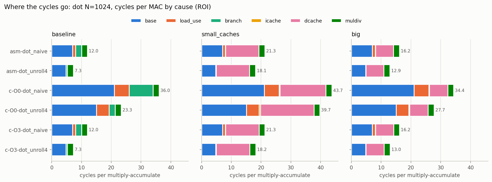
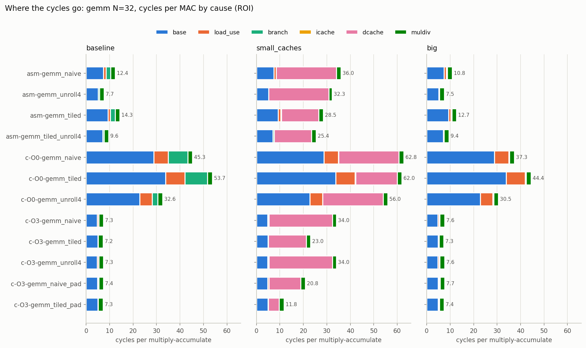
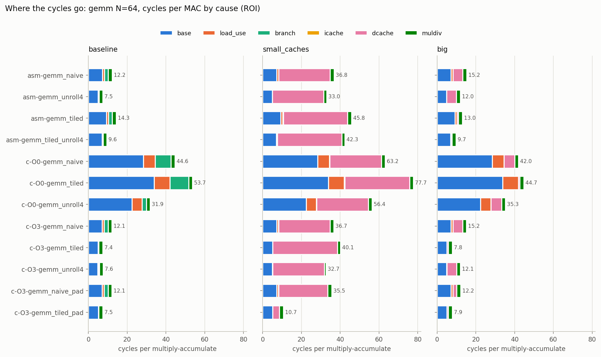
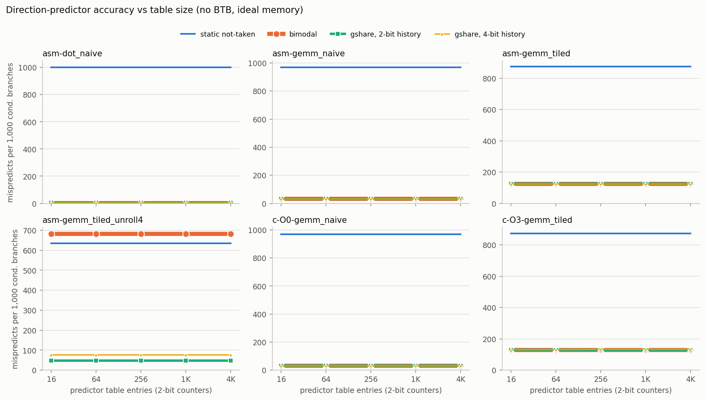
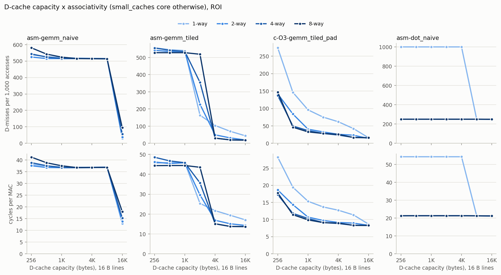

# Phase 6 plots (generated by scripts/plot.py; do not edit)

Generated from the sweep CSVs in `results/phase6/sweeps` with matplotlib 3.6.3. Each figure's source CSV is its table view; the sweep's `.provenance.txt` and `.commands.txt` give the machine, the spec and every simulator command.

## CPI stack as cycles per MAC, dot N=1024, configs baseline / small_caches / big

Source (table view): [`sweeps/cpi_stacks.csv`](sweeps/cpi_stacks.csv)

## CPI stack as cycles per MAC, gemm N=32, configs baseline / small_caches / big

Source (table view): [`sweeps/cpi_stacks.csv`](sweeps/cpi_stacks.csv)

## CPI stack as cycles per MAC, gemm N=64, configs baseline / small_caches / big

Source (table view): [`sweeps/cpi_stacks.csv`](sweeps/cpi_stacks.csv)

## Conditional mispredicts per 1,000 branches vs predictor table size

Source (table view): [`sweeps/bpred.csv`](sweeps/bpred.csv)

## D-cache miss rate and cycles per MAC vs capacity, one line per associativity

Source (table view): [`sweeps/dcache.csv`](sweeps/dcache.csv)
